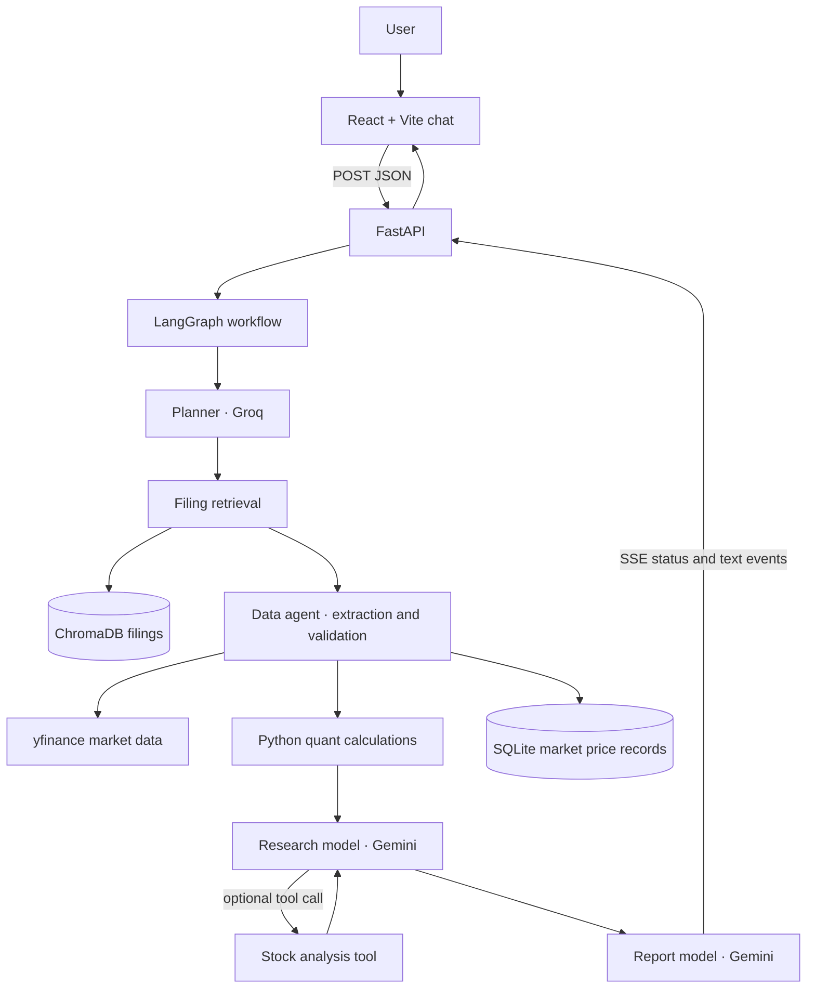

# FinSight

FinSight is a local financial research application for a limited set of Indian listed companies. A user submits a question through a React chat. A FastAPI service validates the request and runs a LangGraph workflow that can retrieve annual-report passages, extract and validate financial statement facts, calculate metrics in Python, and produce a cited natural-language report.

This README documents the implementation present in this repository. It does not describe the Express/MongoDB or Java services mentioned in older planning documents; those services are not part of the current analysis request path.

## Current capabilities

- React and Vite frontend with a chat-based analysis screen.
- FastAPI health, standard analysis, and streaming analysis endpoints.
- LangGraph workflow with planning, filing retrieval, data extraction, quantitative calculations, optional stock-analysis tool use, and report generation.
- Annual-report PDF ingestion into a local ChromaDB collection.
- Filing retrieval filtered by ticker and/or fiscal year when supplied.
- Yahoo Finance historical price retrieval through `yfinance` for five supported tickers.
- Python calculations for statement ratios and price-based market metrics.
- SQLite persistence of fetched daily market-price records.

## Architecture



### Request workflow

1. The React chat sends the question to `POST /api/v1/analysis/stream` on the FastAPI service at `http://localhost:8000`.
2. FastAPI validates the question, optional ticker, and optional dates with the `AnalysisRequest` Pydantic model.
3. The LangGraph planner uses Groq structured output to decide whether filing evidence or stock-performance data is needed and creates up to four filing search queries.
4. The filing retrieval node searches the `finsight_filings` ChromaDB collection. Results can be filtered by ticker and fiscal year, duplicates are removed, and the best-ranked passages are retained with page and source metadata.
5. The data agent uses Groq structured output to propose statement facts from retrieved passages. Python checks the quote, number, unit, reporting period, accounting basis, and source metadata before accepting each fact. When requested and given a ticker plus date range, it fetches market history and writes the returned prices to SQLite.
6. The quant node calculates ratios and market metrics from available validated inputs.
7. The Gemini research node may call the registered `analyze_stock_performance` tool. If it requests the tool, LangGraph executes it and returns the result to the research node.
8. The report node prompts Gemini to write from the available facts, calculations, tool results, and filing passages. It is configured for model streaming.
9. FastAPI converts workflow status and report text into Server-Sent Events (SSE). The frontend reads the POST response as a stream and updates the chat.

The streaming endpoint reports progress during the workflow and streams report text during final generation. Earlier planning, retrieval, extraction, and calculation steps still run before the report tokens are produced.

### LLM roles and deterministic nodes

- **Planner:** Groq model `openai/gpt-oss-120b`, structured as `ResearchPlan`.
- **Financial fact extraction:** Groq model `openai/gpt-oss-120b`, structured as `ExtractionResult`; Python performs source checks and numeric parsing.
- **Research and tool selection:** Gemini, configured by `GEMINI_MODEL` and defaulting to `gemini-2.5-flash`.
- **Final report:** Gemini, using the same configured model; streaming is enabled for this call.
- Filing search, fact validation, and financial calculations are code-driven workflow stages. The LangGraph tool executor is not an additional reasoning agent.

## RAG and document ingestion

The ingestion command is `ai-service/ingest_report.py`. It processes one PDF annual report at a time:

1. `PyPDFLoader` extracts text into page-level documents.
2. `RecursiveCharacterTextSplitter` splits text into chunks of 1,200 characters with 200 characters of overlap, recording the start index.
3. Each chunk receives company, ticker, fiscal year, document type, one-based PDF page number, source URL, filename, and start-index metadata.
4. `sentence-transformers/all-MiniLM-L6-v2` embeds the chunks.
5. LangChain's Chroma integration stores text, embeddings, and metadata in the `finsight_filings` collection at `storage/chroma`.

Example, run from the `FinSight` project directory:

```powershell
python ai-service\ingest_report.py `
  --company "Reliance Industries Limited" `
  --ticker RELIANCE `
  --fiscal-year 2023-24 `
  --pdf "data\sample_data\reliance-2023-24.pdf" `
  --source-url "https://example.com/reliance-annual-report.pdf"
```

Replace the sample PDF path and URL with the real report. The input PDF must contain selectable text for `PyPDFLoader` to extract useful passages; scanned reports may require OCR, which is not implemented here. Chunking is character-based, not token-based. The script creates stable IDs from ticker, fiscal year, document type, page, and chunk number, then calls `add_documents`.

The runtime retrieval used by the graph is `retrieve_filing_evidence` in `backend/app/agents/research_graph.py`. A separate helper also exists at `ai-service/app/rag/retriever.py`; the graph uses its own retrieval implementation. Retrieval uses Chroma similarity search, optional ticker/fiscal-year metadata filters, deduplication, distance-based ranking, and returns up to ten passages to the data and report stages. Distance is a ranking value, not a confidence probability.

An ingestion command must be run to populate the local Chroma collection. Generated Chroma files and sample PDFs are excluded from version control by `.gitignore`; a fresh clone does not include a shared filing corpus.

## Quantitative and market-data scope

### Supported tickers

The `yfinance` integration currently maps these company tickers to Yahoo Finance symbols:

| FinSight ticker | Yahoo Finance symbol |
|---|---|
| `RELIANCE` | `RELIANCE.NS` |
| `TCS` | `TCS.NS` |
| `INFY` | `INFY.NS` |
| `HDFCBANK` | `HDFCBANK.NS` |
| `ICICIBANK` | `ICICIBANK.NS` |

### Metrics

The quant agent groups financial facts by fiscal year, accounting basis, and unit. It calculates values only when the necessary accepted inputs are present and non-conflicting. Implemented statement calculations include:

- Operating margin and net profit margin
- Debt-to-equity ratio
- Current ratio
- Cash flow to net income
- Free cash flow as operating cash flow less capital expenditure, when both validated inputs are available

From fetched market-price series, the quant agent calculates price return, price CAGR, annualized volatility, and maximum drawdown. The registered stock-analysis tool also calculates Sharpe, Sortino, and Calmar ratios. The price return calculations exclude dividends. The tool's Sharpe and Sortino defaults use a 0% risk-free/target rate.

SQLite writes market-price records to `storage/market_data.sqlite3`. The current data-agent path writes fetched rows to this database; it does not use the database as a read-through cache.

## Technology

| Area | Implemented technology | Use in this repository |
|---|---|---|
| Frontend | React, Vite, React Router, React Markdown | Chat UI and streamed report display |
| API | Python, FastAPI, Pydantic, Uvicorn | Request validation, health, analysis, SSE response |
| Workflow | LangGraph, LangChain | Stateful research graph and tool execution |
| LLM providers | Groq, Google Gemini | Planning, structured fact extraction, research, report writing |
| PDF parsing and splitting | PyPDF, LangChain Community, LangChain Text Splitters | Filing text extraction and chunking |
| Embeddings | Hugging Face Sentence Transformers | `all-MiniLM-L6-v2` passage/query embeddings |
| Vector storage | ChromaDB | Filing chunks, vectors, and metadata |
| Market data | `yfinance` | Historical price retrieval |
| Numeric processing | Pandas, Python | Price-series metrics and statement calculations |
| Structured local storage | SQLite | Persisted market-price rows |

Dependencies are listed in the root `requirements.txt` and `frontend/package.json`.

## Local setup

### Requirements

- Python version compatible with the pinned packages in `requirements.txt`.
- Node.js and npm.
- Groq and Google Gemini API keys for the LLM-backed workflow.
- Network access when calling model providers, retrieving Yahoo Finance data, or downloading the Hugging Face embedding model for the first time.

### Configure model keys

The root `.env.example` does not currently declare the model keys used by the workflow. Create or edit `FinSight/.env` and set:

```dotenv
GROQ_API_KEY=your_groq_api_key
GEMINI_API_KEY=your_google_gemini_api_key
GEMINI_MODEL=gemini-2.5-flash
```

`.env` is ignored by Git. Do not commit credentials.

### Start the FastAPI service

From the `FinSight` directory:

```powershell
python -m venv .venv
.venv\Scripts\Activate.ps1
python -m pip install -r requirements.txt
python -m uvicorn backend.app.main:app --reload --port 8000
```

If PowerShell blocks activation scripts, use an already activated Python environment or invoke its Python executable directly. The API health endpoint is `http://localhost:8000/api/v1/health`.

### Start the frontend

In a second terminal:

```powershell
cd frontend
npm.cmd install
npm.cmd run dev
```

Open the URL printed by Vite, usually `http://localhost:5173`. The analysis chat currently calls `http://localhost:8000/api/v1/analysis/stream` directly. FastAPI CORS is configured for `http://localhost:5173`.

## API

### `GET /`

Returns a basic service message.

### `GET /api/v1/health`

Returns:

```json
{"status":"healthy"}
```

### `POST /api/v1/analysis`

Runs the research graph synchronously and returns JSON:

```json
{
  "question": "Summarize Reliance's disclosed risks for FY 2023-24",
  "ticker": "RELIANCE",
  "fiscal_year": "2023-24"
}
```

The response contains `ticker`, `fiscal_year`, and `report`.

### `POST /api/v1/analysis/stream`

Accepts the same request fields and returns `text/event-stream`. Each SSE `data:` frame contains JSON with a `type` field:

- `status`: workflow stage description
- `token`: a piece of the final report text
- `error`: generic error message if the stream fails after it starts
- `done`: indicates the graph completed

Optional date fields must be provided together and use ISO date format (`YYYY-MM-DD`). The data agent requires ticker, start date, and end date to fetch market data. The current chat request infers ticker and fiscal year from the question but does not send start and end dates, so that data-agent fetch path is not available from the current chat UI without extending the request form or request construction.

## Evidence and safety behavior

- The graph prompts models not to invent facts, figures, dates, or citations.
- Retrieved filing text is treated as source data, not as instructions.
- Financial facts are accepted only after source-text checks for quote, number, unit, period, and accounting basis (when specified).
- Conflicting extracted values for the same metric, period, basis, and unit are omitted from ratio calculations with a validation warning.
- Reports are prompted to distinguish `[SOURCED]`, `[CALCULATED]`, `[INFERRED]`, and `[UNCERTAIN]` claims.
- Financial calculations run in Python; LLM-written arithmetic is not treated as authoritative.
- The application is for informational research, not personalized investment advice.

These safeguards reduce unsupported output but do not guarantee that every extracted value or interpretation is correct. Retrieved passages, source PDFs, model outputs, and market data should be independently checked for high-impact use.

## Repository layout

```text
FinSight/
├── backend/
│   └── app/
│       ├── agents/
│       │   ├── research_graph.py  # LangGraph workflow, retrieval, report, SSE stream adapter
│       │   ├── data_agent.py      # Fact extraction/validation and SQLite writes
│       │   └── quant_agent.py     # Ratios and market metrics
│       ├── quant/metrics.py       # Deterministic price-series formulas
│       ├── tools/                 # Market data and LangChain tools
│       └── main.py                # FastAPI routes and request models
├── ai-service/
│   ├── ingest_report.py           # PDF-to-Chroma ingestion CLI
│   ├── app/rag/retriever.py       # Standalone filing retrieval helper
│   └── tests/                     # Current health test file
├── frontend/
│   └── src/
│       ├── app/App.jsx            # Active chat, API request, SSE reader
│       ├── app/App.css
│       └── main.jsx               # React application entry point
├── data/                          # Sample/processed data directories
├── docs/                          # Architecture and evaluation notes
├── storage/
│   └── chroma/                    # Local Chroma persistence (generated/ignored)
├── requirements.txt
└── docker-compose.yml             # References service directories not present in this checkout
```

## Current limitations

- The checked-in frontend home page includes sample company prices and headlines; these are not live market widgets.
- The active chat infers ticker and fiscal year from question text. It has no date-range controls.
- PDF ingestion is a manual command-line job. There is no upload UI, background job queue, OCR pipeline, or ingestion status API.
- The checked-in `storage/chroma` directory is ignored except for `.gitkeep`; each developer must ingest filings locally.
- Market-data retrieval depends on `yfinance` and external availability. SQLite records are written but not used as a cache by the active fetch path.
- Chroma is configured with local persistent storage. No server deployment, authentication, authorization, or multi-user isolation is configured.
- `docker-compose.yml` references `backend/mern-api`, `ai-service` container build files, and `backend/java-service`; those paths are not present in this checkout, so the compose file is not a verified way to run the current application.
- `ai-service/tests/test_health.py` imports `app.main` from the AI-service directory and expects `{"status":"ok"}`. The active FastAPI app is `backend.app.main` and returns `{"status":"healthy"}`, so the checked-in health test does not currently match the active API.
- No accuracy, retrieval-relevance, or citation-correctness score is claimed by this repository.

